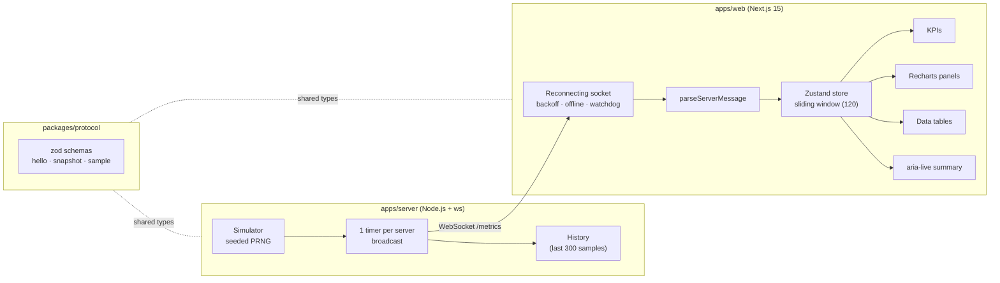
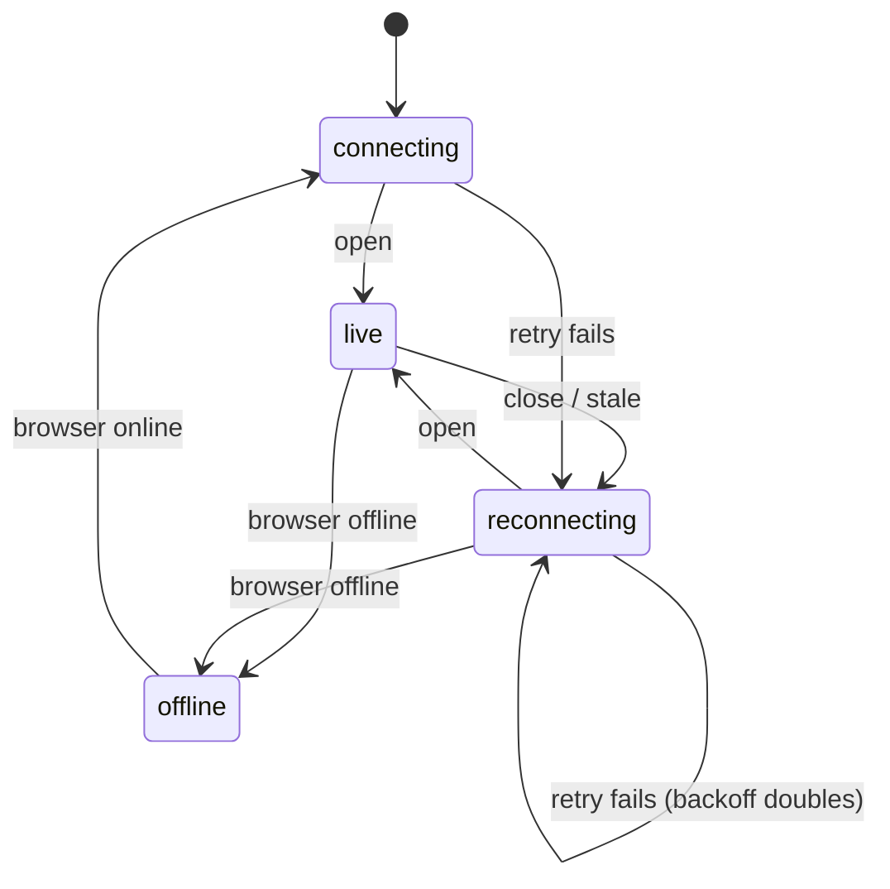

# realtime-metrics-dashboard

[](https://github.com/mhxtecnologia/realtime-metrics-dashboard/actions/workflows/ci.yml)


[](LICENSE)

A live operations dashboard: a Node.js WebSocket server streams simulated store metrics
(sales per minute, p50/p95 latency, errors, online users) and a Next.js App Router client
charts them in real time. It is built to show three things done properly:

- **Real-time plumbing** — automatic reconnection with exponential backoff and jitter,
  offline detection, stale-connection watchdog, every message validated with zod.
- **Rendering discipline** — a small Zustand store with a bounded sliding window; each
  widget subscribes only to its slice, so a new sample never re-renders the whole page.
- **Accessibility as a feature, not an afterthought** — WCAG 2.2 AA verified by axe in
  end-to-end tests, in both light and dark themes.

## Architecture



The connection is a small state machine, and every state is both visible and announced
to screen readers:



## Technical decisions

| Area | Decision | Why |
|---|---|---|
| Monorepo | pnpm workspace: `apps/web`, `apps/server`, `packages/protocol` | One contract shared by both sides; the server and client cannot drift apart. |
| Protocol | zod schemas with `.strict()`, size limit before `JSON.parse`, version in `hello` | Socket data is untrusted input. Invalid frames are counted and dropped, never thrown. |
| Reconnection | Exponential backoff with *equal jitter* (`cap/2 + random·cap/2`), capped at 30 s | Spreads reconnections when the server restarts under many clients. |
| Backoff reset | Only after the first message, not on `open` | A server that accepts and drops at once cannot cause a reconnect loop. |
| Offline | `online`/`offline` events pause retries entirely | No wasted attempts while there is no network; reconnects as soon as it returns. |
| Stale watchdog | No message for 10 s → reconnect | Detects half-open TCP connections that never fire `close`. |
| State | Zustand vanilla store + selectors, window capped at 120 samples | Bounded memory; the page shell subscribes to nothing, only widgets do. |
| Pause | `samples` keeps updating, `visible` freezes | WCAG 2.2.2 (Pause, Stop, Hide) without losing data while paused. |
| Charts | Recharts inside `role="img"` with a computed `aria-label`, plus a data table | The chart is visual; the table is the accessible equivalent (WCAG 1.1.1). |
| Live region | Summary updates at most every 10 s; status changes in a separate `role="status"` | Announcing every sample (1/s) would make a screen reader unusable. |
| Reduced motion | `prefers-reduced-motion` disables Recharts animation and CSS pulses | WCAG 2.3.3; on the server render the chart assumes reduced motion. |
| Theme | System / light / dark radios, applied by a nonce-protected boot script | No flash of the wrong theme; native radios give keyboard support for free. |
| Security | Nonce-based CSP via middleware, Origin allow-list on the socket, broadcast-only channel, `maxPayload` 1 KB, slow-consumer drop | Blocks cross-site WebSocket hijacking and keeps a slow client from growing server memory. |
| Server | One `setInterval` for all clients, ping/pong heartbeat, graceful shutdown (1001) | O(clients) per tick, dead peers are terminated, deploys do not look like crashes. |
| Images | Multi-stage Dockerfile, two distroless `nonroot` targets | Small attack surface; the server is a single bundled file. |

## Run it

With Docker (one command):

```bash
docker compose up --build
```

Open <http://localhost:3000>. The WebSocket server listens on `ws://localhost:4000/metrics`
and exposes `GET /healthz`.

Locally (Node 22 + pnpm 10):

```bash
pnpm install
pnpm dev          # web on :3000, server on :4000, both with hot reload
```

Configuration lives in environment variables; see [`.env.example`](.env.example).

| Variable | Default | Used by |
|---|---|---|
| `PORT` | `4000` | server |
| `TICK_MS` | `1000` | server — interval between samples |
| `ALLOWED_ORIGINS` | `http://localhost:3000` | server — comma-separated Origin allow-list |
| `MAX_CLIENTS` | `500` | server |
| `SEED` | random | server — fixed seed for a reproducible stream |
| `NEXT_PUBLIC_WS_URL` | `ws://localhost:4000/metrics` | web — baked into the bundle at build time |

## Tests

```bash
pnpm lint        # ESLint (next/core-web-vitals + typescript-eslint strict)
pnpm typecheck   # tsc --noEmit in every package, strict + noUncheckedIndexedAccess
pnpm test        # Vitest: protocol, server, store, socket, components
pnpm build
pnpm e2e         # Playwright + axe, starts both servers
```

- **Protocol** — valid and invalid frames, size limit, version, p95 ≥ p50, snapshot cap.
- **Server** — real `ws` clients against a server on port 0: message order, Origin
  allow-list (403), unknown path (404), client limit (503), broadcast-only close (1003),
  graceful shutdown (1001), health check. The simulator is checked against the schema over
  5,000 ticks.
- **Web (Vitest + Testing Library)** — sliding window reducers, the reconnecting socket with
  a fake WebSocket and fake timers (backoff, reset rule, offline, watchdog, stop), the store
  (validation, pause), and the components (status badge, live region throttling, pause
  toggle, theme radios, tables).
- **End to end (Playwright + @axe-core/playwright)** — zero WCAG 2.2 A/AA violations in light
  and dark themes with every table open, keyboard-only operation (skip link, focus ring,
  pause, theme, tables), pause freezing the charts, reduced motion turning animations off,
  offline → live recovery, and the CSP header.

## Project layout

```
apps/
  server/     WebSocket server: config, simulator, broadcast, heartbeat
  web/        Next.js App Router: components, store, socket client, e2e tests
packages/
  protocol/   zod schemas and types shared by both apps
```

## License

[MIT](LICENSE) © Matheus Henrique Takeuchi
